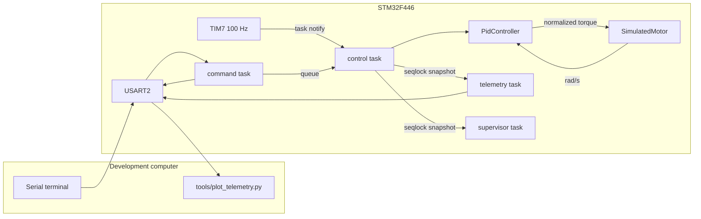

# Architecture

Phase 1 keeps the speed controller, the plant, and the board support apart so a later encoder and PWM stage can replace the simulated plant without rewriting the tasks.

## Modules

| Path | Owns | Must not |
| --- | --- | --- |
| `src/mtr/pid.*` | Discrete PID | FreeRTOS, HAL, a particular motor |
| `src/mtr/motor_plant.hpp` | `MotorPlant` surface: torque command, load, feedback-valid, step, speed | Scheduling |
| `src/mtr/simulated_motor.*` | Forward-Euler mechanical plant | PWM, encoder, FOC |
| `src/mtr/control_loop.*` | One sample: read, PID, command, step, fault report | How the sample is released |
| `src/mtr/fault_policy.*` | Stopped / running / faulted and the trip counters | GPIO or driver enable pins |
| `src/mtr/command.*` | Parser and range checks | UART |
| `firmware/app` | Tasks, queue, mutex, snapshot publication | The PID equations |
| `firmware/platform` | Clock, TIM6, TIM7, USART2, DWT, LED | Control gains |
| `firmware/rtos` | `FreeRTOSConfig.h`, assert and stack hooks | Application policy |

`MotorPlant` is the Phase 2 seam. It is one concrete class today (`SimulatedMotor`), not a device framework. A later position/velocity source and a torque or current command would implement the same methods or a small extension of them. The 100 Hz task would still call `sample()`.

## Tasks

Priorities are FreeRTOS priorities. The control task must be able to preempt anyone who shares the CPU, because a late wake is a deadline miss. The command task sits above the supervisor so a typed command is not stuck behind a 100 ms diagnostic pass. Telemetry is below the supervisor so a full transmit buffer cannot delay fault handling. The load task sits just above idle so `load on` removes idle time without starving the console; it yields because time slicing is off, otherwise `load off` could not run at the same priority.

| Task | Priority | Stack (words) | Blocks on | Period |
| --- | --- | --- | --- | --- |
| control | 5 | 512 | `ulTaskNotifyTake`, 50 ms cap | 100 Hz, TIM7 |
| command | 4 | 768 | notification per received byte, TX mutex | event |
| supervisor | 3 | 384 | `vTaskDelayUntil` | 100 ms |
| telemetry | 2 | 512 | `vTaskDelayUntil`, TX mutex | 100 ms, and only if enabled |
| load | 1 | 256 | notification while disabled | busy 0.5 ms slices when enabled |
| idle | 0 | 256 | — | — |

All of those objects are created with the static FreeRTOS API. `configSUPPORT_DYNAMIC_ALLOCATION` is 0. There is no application heap; `_sbrk` returns failure.

The command task is the only writer of the command queue. The control task is the only reader, and the only caller of the PID and the plant. Parameter changes do not take a mutex on the control path.

## Interrupts

| Source | NVIC priority | FreeRTOS |
| --- | --- | --- |
| TIM6 (HAL tick) | 2 | none. More urgent than the syscall ceiling |
| TIM7 (control release) | 6 | `vTaskNotifyGiveFromISR` |
| USART2 | 7 | notify the command task, move one TX byte |
| SysTick, PendSV, SVC | kernel, lowest | port |

`configLIBRARY_MAX_SYSCALL_INTERRUPT_PRIORITY` is 5, so an ISR at priority 2 must not call the kernel. TIM6 only increments `uwTick`. Priority 6 and 7 are legal for FromISR calls. The USART handler does not parse and does not print.

## Control-loop sequence

One wake performs one sample. If several TIM7 notifications have piled up, the extra count is added to the deadline-miss counter and is not replayed. A 50 ms wait with no notification is one miss. That is deliberate: coalescing the notifications and also reporting zero misses would hide the fault the counter exists to catch.

On each wake, in order:

1. Account misses and queue overflows.
2. Drain the command queue and apply it (start, stop, gains, load, injections).
3. Read `w[k]` from the plant. That speed is the PID measurement and the speed published in the snapshot.
4. If faulted, command zero torque and do not integrate.
5. If stopped, command zero, reset the PID, and still integrate, so the rotor coasts.
6. If running, compute the PID output, apply it, and integrate one Euler step to `w[k+1]`. An overspeed or non-finite step is not committed.
7. Convert the DWT stamps to microseconds and publish the snapshot.

Publishing the pre-step speed keeps `error_rpm` equal to the error the PID used. The plant's new speed is the measurement at the next sample.

## Shared data

The snapshot is a seqlock. The control task is the only writer. Readers (telemetry, supervisor, `status`) copy words and retry if the sequence changed. The writer does not block. There is no mutex on this path.

USART TX is the one shared mutable resource that needs a lock: the command task and the telemetry task both produce text. A priority-inheritance mutex covers a whole line. Bytes sit in a 1024-byte ring; the ISR drains it. RX is a 256-byte ring filled by the ISR. Both rings drop on overflow and count the drop. The command queue is 8 deep with a zero timeout; overflow increments a counter and, after 8, trips `kFaultQueue`.

## Faults

| Bit | Name | How it trips |
| --- | --- | --- |
| 0 | deadline | 3 accumulated misses, or the supervisor's stall request |
| 1 | feedback | `feedback_valid` cleared, including `fault inject feedback` |
| 2 | overspeed | Euler step would pass 2500 RPM. The step is discarded |
| 3 | numerical | non-finite speed, command, or a rejected PID update |
| 4 | queue | 8 command-queue overflows |
| 5 | overrun | 3 consecutive control bodies longer than the 10 ms period |

A trip forces the faulted state. Torque command stays zero and the plant is not integrated, so a diverging sample cannot keep moving the model. `reset faults` clears the latches and leaves the state stopped. `start` does not clear a fault.

The supervisor also watches `sample_count`. If it does not change for three 100 ms passes while the state says running, the supervisor sets a safe-request flag and stops TIM7. The control task treats that flag as an immediate deadline trip. Stopping the timer is what makes a stuck control path visible even if the task itself never runs again; the command task can still report the fault if the CPU is otherwise free.

`vApplicationStackOverflowHook` and `configASSERT` call `board_panic`. The panic path turns interrupts off, writes a short line on USART2 by polling, and blinks LD2. A `HardFault` prints PC, LR, CFSR, and HFSR the same way, then panics. This is a diagnostic, not a recovery.

## Memory

The image has no heap. Queues, the mutex, task TCBs, and task stacks are static. The control sample does not allocate.

The local link of this tree reported:

| Region | Size | Notes |
| --- | --- | --- |
| Flash | 60552 bytes, 11.55% of 512 KiB | `size` text 60060, data 480 |
| SRAM | 18408 bytes, 14.04% of 128 KiB | includes the 4 KiB main-stack reservation |
| `.bss` end | `0x200037e8` | task stacks live here |
| Main SP | `0x20020000` | top of SRAM, grows down |

Those figures are linker output, not a measurement of spare stack at run time. `stats` prints `uxTaskGetStackHighWaterMark` for each task. The marks from the board run are in [verification](verification-validation.md).

## Console wiring

USART2 is PA2 (TX) and PA3 (RX), alternate function 7, 115200 8N1. On a factory NUCLEO-F446RE those pins reach the ST-Link virtual COM port through solder bridges SB13 and SB14, which are fitted with 0 Ω resistors. SB62 and SB63 are open. Closing SB62 and SB63 would disconnect the ST-Link and connect PA2 and PA3 to the Arduino D1 and D0 headers instead. Leave them open.

CN2, with both jumpers fitted, is the SWD connection to the target. CN3 is an unpopulated header on the same TX and RX nets, used as test points. JP5 at U5V and JP6 fitted are the usual USB-powered configuration.

The on-board ST-Link on the board used for bring-up did not deliver host bytes to PA3 at firmware V2J33M25. After that probe was updated to V2J47M34, the same USART2 image answered `help`. OpenOCD on this probe connects under reset at 480 kHz; see `firmware/openocd/nucleo_f446re.cfg`.

## Clocks

HSE bypass is the 8 MHz MCO from the ST-Link. PLL: M = 8, N = 360, P = 2, Q = 7, R = 2, voltage scale 1, overdrive, flash latency 5. SYSCLK is 180 MHz. APB1 is 45 MHz and its timers run at 90 MHz. APB2 is 90 MHz. USART2 is on APB1; the HAL baud divider programs BRR = 391, which is the divider for 115200 at 45 MHz. `main` does not start the scheduler unless `SystemCoreClock` is 180000000, matching `configCPU_CLOCK_HZ`.
